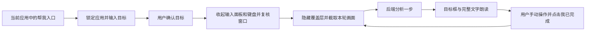
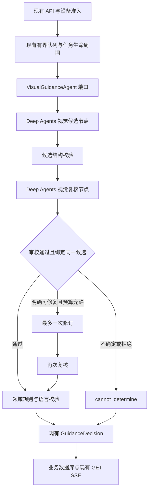

# Deep Agents 重构优化方案

设计日期：2026-10-31。设计基线包含当时工作区已有的 DeepAgents 升级与 Android 首页改动。下文保留设计时的依据与验收目标。

实施更新（2026-10-31）：P0–P3 的工具边界、固定视觉工作流、资源选择、有界历史和客户端恢复拆分已落地，并完成离线与模拟器验证。默认仍为 `legacy_hardened`；P1/P2 的真实模型质量与性能门槛、P4 真机试点尚未验收。具体行为、配置及测试结果以[第 65 模块实施记录](learning/65-bounded-guidance-workflow.md)为准。

建议保留现有客户端交互、HTTP 协议和单机试点架构，将模型内部组织方式收敛为**受限的 Deep Agents 节点 + 代码控制的单步流程 + 独立结果校验**。优先修补工具权限与审校闭环，再验证减少模型调用和容器开销的收益。

截至核验日，Python SDK 最新稳定发行版为 **deepagents 0.7.32**；工作区的依赖声明、锁文件及已安装环境均已使用该版本。0.7.32 的发行说明主要涉及导入性能改进，升级版本本身不等于改善指引质量。[PyPI](https://pypi.org/project/deepagents/)、[官方发行记录](https://github.com/langchain-ai/deepagents/releases/tag/deepagents%3D%3D0.7.32)

## 1. 保持现有交互和协议

用户仍从当前应用的“帮我”悬浮入口开始，输入并确认目标，等待本轮截图分析，阅读和收听一条指引，手动操作后点击“我已完成”。无法判断时仍使用“重新识别”，结束方式和首页设置入口保持现状。



以下行为作为重构的回归约束：

- 目标确认前不截图、不联网；后续新截图只由用户下一步或重新识别动作触发。模型内部复核复用本轮图片。
- 保留设备邀请、额度、会话令牌、包名锁定、截图前隐藏覆盖层、系统栏坐标换算、显示几何变化后失效。
- 不遍历或保留无障碍节点文字，不调用节点动作和手势；目标框保持不可触摸，入口及控制按钮只控制求助会话。
- 保留完整指令、分段 TTS、朗读区间同步滚动和手动阅读，不以截断文字换取简短。
- 保留现有 HTTP 路径、鉴权头、`client_turn_id`、GET/SSE、`schema_version=1.0` 和三个结果状态。
- 内部候选、审校记录、阶段和拒绝原因不添加到现有响应中。[AgentProtocol.kt](../android/app/src/main/java/com/xisha/guojing/data/AgentProtocol.kt) 要求字段集合完全相同，增加“可选字段”也会使当前客户端拒绝响应。

本轮设计不恢复教程编辑、应用选择器、管理员网页或人工审核，也不引入新的用户审批步骤。

## 2. 当前实现与改进依据

现有分层、设备配额、有界队列、幂等回合、截图不入库及恢复机制应继续使用。主要改进点集中在下面几处。

| 当前事实 | 对本项目的影响 | 改进方向 |
|---|---|---|
| 主模型选择 `ui-analyst → guidance-reviewer`，调用结束后扫描消息校验顺序 | 错误顺序可能已产生调用和成本，才被最终校验发现 | 短期执行前校验；目标架构由代码固定阶段 |
| 审校结果只有 `approved/feedback`，`approved=false` 后主模型仍可修改并返回 | 最终输出没有绑定到一份被通过的候选；修订也没有再次审校 | 不可变候选、审校绑定、修订后重新审校 |
| 审校初始输入只有文字分析和候选 | 无法独立核验候选框与当前图片的一致性 | 新链路复核直接接收本轮图片和候选 |
| 两个声明式子智能体配置 `tools=[]` | 只取消额外工具，框架仍装配内置文件工具；文字输入隔离不等于文件访问隔离 | 缩小工具暴露面，并在执行边界拒绝未允许工具 |
| 现有真实图离线成功路径为 5 次模型调用 | 主模型承担多次路由，含图片的上下文反复进入请求 | 合并视觉理解与候选生成，正常路径目标为 2 次调用 |
| `_run_context` 加入全部历史说明，并称其为 validated steps | 上下文随轮数增长；历史指引并非已执行操作的证明 | 有界历史，区分“已发出指引”和当前屏幕事实 |
| 协调器每轮无条件申请 Docker，启动和 ready 检查依赖 Docker | 去掉模型工具后仍会支付容器开销 | 在工具收敛验证后调整资源生命周期与就绪检查 |
| `AgentSessionController.kt` 当前约 769 行 | 准入、截图、上传恢复、SSE、状态与展示耦合，修改容易波及交互 | 保持端口与页面，按状态转换及副作用拆分 |

代码依据：[DeepGuidanceAgent](../src/guojing/infrastructure/agents/deep_guidance_agent.py)、[编排校验](../src/guojing/infrastructure/agents/validation.py)、[结构化输出](../src/guojing/infrastructure/agents/outputs.py)、[协调器](../src/guojing/application/agent/coordinator.py)、[组合根](../src/guojing/main.py)、[客户端会话控制器](../android/app/src/main/java/com/xisha/guojing/session/AgentSessionController.kt)。

本次使用项目原有离线测试的脚本模型运行实际安装的 Deep Agents 图，并观察送给模型的工具定义：主智能体和视觉子智能体仍可见文件工具及 `task`，审校可见文件工具。测试使用临时文件后端，没有 Docker，因此该次观察不包含 `execute`；生产沙箱实现执行接口，上游会据后端能力提供该工具。Fork 中出现 `task` 不代表上游允许无限递归，其内部另有递归阻断。

这些发现与 0.7.32 的[图构建源码](https://github.com/langchain-ai/deepagents/blob/deepagents%3D%3D0.7.32/libs/deepagents/deepagents/graph.py)一致：`tools` 是增量配置，声明式子智能体也会获得默认中间件。

## 3. Deep Agents 能力取舍

继续使用 `create_deep_agent` 的模型适配、结构化输出和中间件扩展能力；固定顺序由 LangGraph `StateGraph` 或等价的显式异步流程负责。两种实现中，框架类型都留在基础设施层，应用层只依赖 `VisualGuidanceAgent`。

这符合上游对预定工作流和动态智能体的区分：工作流使用预先定义的路径，智能体自行选择步骤。[LangGraph 工作流说明](https://docs.langchain.com/oss/python/langgraph/workflows-agents)

| 能力 | 本项目采用方式 |
|---|---|
| `create_deep_agent`、`ToolStrategy` | 用于有明确输入输出的视觉候选和复核节点 |
| Middleware、HarnessProfile、permissions | 用于工具收敛、模型预算、数值指标和兼容性约束 |
| `mode="fork"` | 保留在受限旧链路用于回退；新链路显式传递当前图片，不依赖继承整段父上下文 |
| `CompiledSubAgent` | 将来确有委派需求时使用；当前固定两阶段直接由代码调用，无需额外主模型路由 |
| Skills、长期 Memory | 当前不引入；中文表达等固定规则继续随代码版本维护，不建立应用教程或用户截图记忆库 |
| AsyncSubAgent、动态多智能体、远程托管 | 当前 90 秒单步流程没有对应需求，不接入 |
| Checkpointer、完整 tracing | 当前流程不启用；继续用业务数据库恢复任务状态，避免保存模型图片和完整消息 |

上游也建议对简单单步任务评估子智能体开销；禁用默认子智能体有专门配置，不能假定 `subagents=[]` 就足够。[子智能体文档](https://docs.langchain.com/oss/python/deepagents/subagents)

## 4. 目标调用链



再次复核未通过同样进入 `cannot_determine`，不存在绕过复核的修订出口。无效候选也不能进入展示出口。

### 4.1 视觉候选

输入仅包含用户确认的目标、目标包名、当前截图和有界文字历史。一次生成内部 `GuidanceCandidate`：

- `status/instruction/target/confidence`：与现有最终结构对应。
- 当前画面中的目标描述、候选依据，以及完成状态所需的可见证据。
- 内部风险分类与不确定原因，用于规则检查和评测；不把模型分类当作执行授权。

候选阶段同时完成当前界面理解与一步规划，不再要求枚举最多 20 个无关控件。`completed` 必须有当前截图支持，目标控件不存在不能直接推导出完成。

### 4.2 独立视觉复核

复核输入是**本轮截图 + 用户目标 + 冻结候选**，不继承候选生成过程中的完整对话。检查目标是否可见且唯一、文字与位置是否一致、是否只有一个手动步骤、完成证据是否成立、语言与产品边界是否符合。

运行器为规范化候选计算标识，将审校结果绑定到该候选和本次 run；不能只信模型自报的标识。通过后直接转换已审核的候选，不再安排一个主模型重新改写最终指令。任意修改都生成新候选并重新复核。

两个节点初期使用相同的已配置视觉模型，避免同时更换模型和编排导致无法归因。独立上下文仍可能出现相关错误，因此复核提升多少必须通过留出集验证。

### 4.3 确定性决策规则

- 结构、枚举、有限数值、正面积矩形及整图归一化坐标在代码中校验。
- `continue` 必须有完整指令、目标框、复核通过和达到既有阈值的分值；其他状态不携带框。
- 复核否决、目标歧义、完成证据不足、越过产品边界时，返回现有 `cannot_determine`。
- 仅措辞或结构等明确可修复问题允许一次修订；缺少视觉证据不能靠循环生成补齐。修订也使用同一张图，不触发新截图。
- 模型、网络和超时故障继续走已有 `failed/error_code/retryable`，不要与正常的“无法判断”混成一种结果。
- 金融及不可逆操作的拦截规则放在纯领域策略中，遇到相关候选或不确定时停止推进；关键词和模型分类都不被宣称为完整识别保障，也不新增“确认即可继续”的按钮。

保留 `confidence` 对当前客户端的兼容语义及 0.70 下限；将其视为启发式分值，不能直接宣称是正确概率。接受与否还必须满足复核和规则条件，不能通过填 1.0 或任意相乘不同分数来绕过阈值。

指令仍优先使用简短的一步说明。当前模型输出上限 80 字、领域与客户端上限 300 字，应明确为“生成偏好/兼容硬上限”的不同职责；是否调整 80 字限制以完整表达必要输入，依据专项评测决定，任何路径都不静默截断。

### 4.4 调用数和时间预算

| 项目 | 设计约束 |
|---|---|
| 正常路径 | 候选 1 次 + 复核 1 次，共 2 次模型调用 |
| 一次修订路径 | 再加修订 1 次 + 复核 1 次，最多 4 次 |
| 图内格式重试 | `ToolStrategy` 明确关闭隐式错误重试；需要修复时进入统一预算流程 |
| 后备总上限 | 保留现有每轮 12 次硬上限，另加阶段限制；格式错误、修订和任何额外模型调用均计入 |
| 截止时间 | 保留排队 30 秒、运行 90 秒、清理 5 秒；阶段共用运行截止时间，不逐阶段重置 |
| 额度 | 第一次实际模型调用开始时记一次设备用量；不会因两个节点变成两次设备额度 |
| 失败处理 | 不在同一轮静默切换供应商或追加整条旧链路；用户仍使用既有重新识别入口 |

2 次与 4 次是待实现的调用上限，不是当前线上成绩。还需处理模型不调用输出工具的情况：阶段模型调用预算到达后直接结束，不能让 Deep Agents 自行延长循环。

## 5. 工具权限与 0.7.32 的具体适配

采用“模型看得见的工具”和“执行端允许的工具”两层约束：

1. 启动时一次性注册共同的最小 HarnessProfile，禁用隐式 `general-purpose`，通过公开 `excluded_tools` 隐藏文件和执行工具。新节点不声明同步子智能体，因此没有 `task`。
2. 通过公开中间件在每次模型调用前检查工具集合；各节点只允许自己的结构化输出。对实际工具调用再做拒绝检查，即使模型生成了未展示的工具名，也不能产生文件、命令或委派副作用。
3. 过渡期旧主智能体只额外允许两个固定 `task`，执行前校验当前阶段、参数和调用次数。视觉/审校子智能体不能访问文件或继续委派。
4. 为各角色明确配置文件 permissions，默认拒绝；所有自动卸载、摘要和后端直连路径也需检查。新链路的模型后端不实现命令执行，不暴露宿主机或其他 run 的文件。
5. 运行真实 Deep Agents 图的契约测试检查实际工具定义及拒绝行为；依赖升级时任何新增内置工具必须被默认拒绝。

0.7.32 的公开 API 有三项需要落实到实现，而不能用近似配置替代：

- `create_deep_agent` 没有实例级 `harness_profile` 参数，当前注册按模型键影响整个进程。旧、新链路使用同一份最低权限配置；禁止按请求修改再恢复全局注册表。若未来要求同一模型在不同场景具有冲突权限，采用进程隔离或不依赖全局配置的适配。
- 不能从 `excluded_middleware` 删除 `FilesystemMiddleware` 或 `SubAgentMiddleware` 等受保护组件。框架保留组件不等于必须给模型开放其全部工具。
- `FilesystemMiddleware(tools=[])` 在该版本会报错，显式列表必须含 `read_file`。若采用工具白名单替换，使用合法的 `tools=["read_file"]`，再配合 profile 隐藏与执行端拒绝；不要把空列表当作无文件权限。

以上依据为该版本的[图构建实现](https://github.com/langchain-ai/deepagents/blob/deepagents%3D%3D0.7.32/libs/deepagents/deepagents/graph.py)与[文件中间件实现](https://github.com/langchain-ai/deepagents/blob/deepagents%3D%3D0.7.32/libs/deepagents/deepagents/middleware/filesystem.py)。permissions 主要约束中间件工具调用，不能替代后端隔离。

## 6. 上下文、资源和可观测性

### 有界文字历史

先采用最近 6 条完整指引、最多约 4,000 字的可配置窗口作为评测起点；超限移除整条最旧记录，不截断操作条件。始终保留用户目标和最后一条指引，不自动调用模型总结历史。具体上限根据多轮留出集调整。

历史表示“系统之前发出的指引”，不能标为已执行事实。用户点击“我已完成”仅允许再次观察；真正的进展与完成仍由当前截图判断。重复指引结合当前证据和已保存图片摘要检查，疑似无进展时返回无法判断；相同摘要本身不构成继续执行或复用旧框的依据。

### 逐轮资源

第一阶段继续使用已有 Docker 隔离和清理机制，避免同时更改工具、编排及资源生命周期。

当新链路证明不需要文件和执行工具后，默认路径仅在本轮内存中持有图片，不再把图片额外上传沙箱。届时再将沙箱申请/清理移入仍需要它的旧实现，调整 `VisualGuidanceAgent` 的沙箱参数、组合根、`ready` 检查、关闭流程及部署文档。只改模型函数不能消除 Docker 依赖。

每个 run 的图状态和临时后端独立；允许复用模型客户端和不可变配置，不缓存含图片的消息、图状态或候选。暂不为图编译引入缓存，先量出该部分耗时。数据库继续只保存既有安全元数据与最终步骤，不增加 Redis、向量库或持久化 agent 记忆。

取消和超时向模型请求传播，资源在 `finally` 释放；旧路径的沙箱清理失败继续使服务不可就绪。图片、Base64 和 SDK 的不可变对象无法保证物理清零，应减少复制并尽快释放，仅对可变缓冲尽力覆盖。不得将“未写数据库”表述为“所有内存均已擦除”。

### 数值化指标

在现有数值日志与内部状态接口上增加：队列等待、沙箱准备、候选生成、复核和清理耗时；各阶段调用数与 tokens；拒绝原因枚举、修订次数、内部引擎/提示词版本。可记录随机 run 标识用于关联，不记录目标文本、控件标签、截图、完整模型消息或原始错误正文。

保持 `tracing_context(enabled=False)`，测试父节点、复核、异常和修订路径均生效。模型上下文压缩、工具结果卸载和摘要调用一并纳入工具权限与调用预算验证，不让它们产生隐式留存。

## 7. Android 内部拆分

已建立的 `AgentSessionPort`、`AgentRepository`、截图、覆盖层和语音端口继续作为边界，Compose 页面仍依赖端口。建议逐步提取以下职责，不为拆文件增加新的产品状态或页面：

| 模块 | 职责 |
|---|---|
| `SessionReducer`，位于 `session/` | 纯状态转换；集中校验会话代次、当前 run 和事件是否仍有效 |
| `RunRecovery`，位于 `session/` | 丢失响应后的 turn 查询、SSE 转轮询、取消及终态处理 |
| `ConfirmedCapture`，位于 `session/` | 将用户确认/下一步动作与一次截图绑定，协调持久化 turn ID、上传和缓冲释放 |
| 现有 Controller | 组合端口、分派事件、公开不可变 StateFlow；不直接承载所有恢复分支 |

完善以下现有交互边界：

- 提交响应丢失时先 `GET turn`：已找到且运行中则恢复监听，已完成则按当前展示资格处理；仅明确需要重新识别且用户再次操作时才创建新 turn。不要把“查到了原任务”直接等价成“取消它并重截”。
- 每次异步结果都核对 session generation、session ID、run ID；结束后或新会话中的迟到响应不能重新显示旧框、朗读或写回旧状态。
- 输入前锁定的窗口在输入面板及键盘收起后复核；截图前后及结果展示前检查包名、窗口身份和显示几何。对失败给出现有重试提示，不自动截图补偿。
- 进程重启后的旧 `continue` 结果只用于恢复任务背景，仍要求用户重新识别当前画面，不自动重放坐标。
- 元数据检查不能证明同一窗口内所有内容都未变化，不能把它宣传为视觉稳定性检测；解决此类问题仍依赖用户触发的新截图。

每个新阻断原因增加纯 JVM 用例；再用设备测试复验入口、确认、下一步、重播、结束和断网恢复。整体布局不调整，现有暖白朱红首页和悬浮控件继续使用。

## 8. 文件与依赖边界

按需求新增少量模块，避免引入没有使用场景的通用 agent 平台：

| 路径 | 拟议职责 |
|---|---|
| `domain/guidance_policy.py` | 不可变候选/审校值对象及接纳规则；不导入框架 |
| `application/agent/context.py` | 确定性的历史选择和预算规则 |
| `infrastructure/agents/workflow.py` | 两个受限节点及固定流程，实现现有应用端口 |
| `infrastructure/agents/harness.py` | Deep Agents 版本适配、公开配置与工具边界 |
| 现有 `outputs.py / prompts.py / validation.py` | 分别维护模型 DTO、提示词及框架结果到领域对象的验证转换 |
| 现有 `coordinator.py / usage.py` | 任务生命周期、配额、共同截止时间与预算；不处理模型消息 |
| `tests/` 对应目录 | 领域策略、真实图兼容性、工作流及取消/恢复回归 |

框架只用于 `infrastructure`，外层服务继续依赖协议。先沿用当前依赖范围和 `uv.lock`，不跟随 master 或其他包的 release。实施时重新核验 SDK 版本，若出现新稳定版本，先跑兼容性用例再单独更新锁文件。

## 9. 实施阶段与回退

| 阶段 | 交付内容 | 完成门槛 |
|---|---|---|
| P0 现有链路加固 | 记录基线；收敛实际工具；调用前限制顺序；审校绑定候选、否决不直接放行；统一阶段数值指标 | 实际图证明未允许工具无副作用，缺失/乱序/重复/篡改审校全部拒绝，旧协议回归通过 |
| P1 固定双阶段 | 新增候选与视觉复核工作流，保留加固旧实现；同模型对照；正常 2 次、最多 4 次预算 | 领域/图/API 测试通过；质量达到留出集门槛；无额外响应字段 |
| P2 资源优化 | 新路径取消不必要沙箱上传与创建，调整就绪/清理/部署；有界历史 | 无跨 run 状态泄漏；取消/超时清理通过；含资源开销的性能对照成立 |
| P3 客户端内部整理 | 拆分会话状态、恢复与截图协调，覆盖迟到结果和丢响应分支 | JVM、lint、构建、设备交互回归通过；既有用户流程保持一致 |
| P4 小规模试点 | 固定引擎配置，先 3 人观察 48 小时，再扩大到现有设备上限 | 实际错误率、时延、用量和恢复表现满足门槛；具备快速配置回退 |

初步工作量为后端 P0–P2 约 6–10 人日、Android P3 约 2–3 人日；假设现有构建环境可用，评测集整理、模型访问及真机试点另计。实施前用 P0 基线修订估算。

拟新增服务端配置 `GUOJING_GUIDANCE_ENGINE=legacy_hardened|bounded`，初始默认 `legacy_hardened`，未知值启动失败；配置名与取值在实现时与 Settings 和部署文件一起落地。初期无需数据库迁移，也不在同一 run 中自动降级重跑旧引擎。

回退以引擎配置和锁文件版本为单位，排空在途任务后使用既有发布流程重启。旧实现保留 P0 的权限及审校修正；回退不恢复已识别的缺口。若回退目标仍需要 Docker，先验证 Docker 和镜像可用，不能在移除运行依赖后宣称可立即回退。

## 10. 验收与对照评测

本仓库当前合成评测覆盖至少 20 个界面，现有期望集中于 `continue`，以状态与 IoU 为主。它可以检测协议和基本定位退化，不能单独证明中文复杂页面、拒绝、完成判断或多轮效果。[现有评测实现](../tests/evaluation/test_deepseek_integration.py)

构建至少 200 个经授权脱敏或合成场景，按应用/页面族划分校准集与留出集，覆盖中文小字、同名控件、遮挡、键盘、旋转、目标不存在、已完成、敏感操作和截图提示注入，另含至少 20 条多轮任务。现有未跟踪 `img/` 不自动视为可上传的测试素材。

对照组使用同一供应商、模型配置和图片：A 为加固旧链路；B 为单次候选直出，仅做离线消融；C 为拟议双阶段。B 用于判断复核价值，不作为默认上线方案。各组报告超时、拒绝和修订，不能只比较成功样本。

以下是建议准入标准，尚非实测结果：

| 维度 | 门槛与报告方式 |
|---|---|
| 外部兼容 | 当前 Android 协议夹具全部通过；状态、字段、鉴权及幂等行为保持一致 |
| 调用预算 | 理想路径 2 次，修订路径至多 4 次；超限、隐式格式重试与被拒工具均有真实图测试 |
| 状态与定位 | 至少保持现有目标：状态正确率 ≥90%，IoU≥0.5 的比例 ≥80%；同集不劣于 A，并分状态/场景报告 |
| 接纳与拒绝 | 同时报告可回答样本覆盖率、接纳后准确率、目标不存在误放行率及误完成率；不能靠全部拒绝达标 |
| 关键错误 | 留出集中未经复核的输出、注入导致工具副作用、金融/不可逆错误引导为零；同时报告样本数，零观测不代表风险为零 |
| 多轮 | 当前画面支持进展；无依据重复和误完成单独计数；报告完整任务成功率 |
| 性能与成本 | 含队列、资源、网络、复核和修订的 p50/p95；p95 与每个正确有效步骤平均成本争取比 A 改善 ≥20% |
| 生命周期 | 取消、断网、授权失效、进程重启、清理失败、旧响应迟到均不导致重复执行或旧框重现 |
| 隐私 | 图片与完整消息不进入 DB、备份、日志或 tracing；只允许本轮受控内存/旧路径临时沙箱 |

逐步实施时运行对应范围测试；合并前执行仓库既有完整检查：

```sh
uv run pytest
uv run ruff check .
uv run ruff format --check .
uv run mypy
uv lock --check
git diff --check
```

Android 修改后执行 checked-in Wrapper 的 `testDebugUnitTest`、`lintDebug`、`assembleDebug assembleDebugAndroidTest` 和 `connectedDebugAndroidTest`，保留现有 JDK/SDK 约束。真实 Docker、付费模型、云端和真机验收按已有显式启用流程进行。

## 11. 设计阶段验证（实施前）

- 已核对官方稳定 release、0.7.32 标签源码、当前锁文件和实际安装版本。
- 已审阅当前后端编排、配额/队列、HTTP 与 Android 协议、恢复及截图控制路径。
- 执行 `.venv/bin/python -m pytest tests/infrastructure/agents tests/application/agent -q -p no:cacheprovider`：**37 passed**；上游 fork beta 警告 1 项。
- 用原有离线脚本模型运行真实框架图并记录工具名，确认文件工具仍被注入；未调用真实模型或 Docker，也未读取用户截图。
- 设计阶段只新增此文档。后续实现已验证 2/4 次调用边界，视觉复核质量、成本和端到端时延仍待真实评测。
