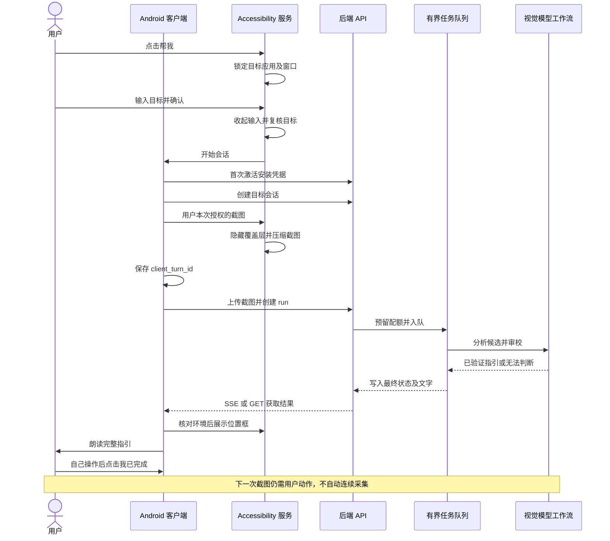
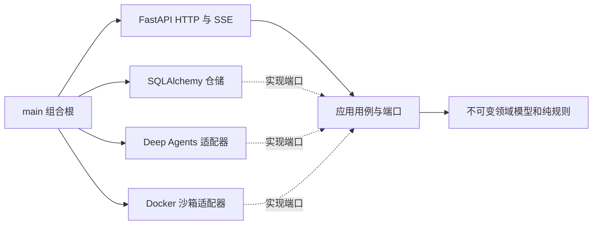

# 老牌子 GuoJing 项目说明与代码审计

审计日期：2026 年 11 月 6 日，Asia/Shanghai。审计基线：`codex/evaluate-jev-vision`，提交 `0e519d5f2f3c4f9349e243d4d7363ec808a1df33`，提交说明 `Refactor visual guidance and session recovery`。

**当前结论：原报告的 2 项 P1、6 项 P2 均已完成代码修复并通过相应自动回归。** 本轮后端 178 项、Android JVM 71 项、Pixel_7 API 36 设备测试 13 项通过；构建和静态检查通过，Android Lint 保留原有 17 条警告。代码修复通过不等于真实模型质量、所有厂商设备或云端运维已验收。

初审基线保持不变；本轮修复基于该基线；以下证据来自提交前工作区验证，未部署。第 7 节保留原始问题、复现和验收要求，第 11 节保留初审验证数据，避免抹去历史证据；最新状态以本节为准。原问题中的行号对应初审基线，当前实现请使用文件及函数名定位。

## 本轮修复复核（2026-11-06）

### 修复和回归对应关系

| 编号 | 修复结果 | 回归证据 |
|---|---|---|
| A01 · P1 | 健康测试显式注入假模型和假沙箱；普通测试清理 `GUOJING_*` 环境变量，默认禁读本地 env，拦截真实 Docker 构造及 HTTPX 网络传输。配置文件测试单独保留受控 env 读取，显式 integration 标记保持原 opt-in。 | [test_audit_regressions.py](../tests/api/test_audit_regressions.py) 检查健康请求成功且真实 Docker registry 的 `start` 从未调用；全套普通测试在拦截器下通过。未连接真实 Docker。 |
| A02 · P1 | 订阅窗口集合变化，追踪前台窗口 ID；目标包滚动、窗口/内容变化使观察代次失效。默认显示器几何变化单独监听。作废旧指引和 TTS，旋转回来也不恢复；截图/上传边界、结果返回及结果落盘后再次核对观察代次。 | [ObservationPolicyTest.kt](../android/app/src/test/java/com/xisha/guojing/observation/ObservationPolicyTest.kt) 和 [AgentSessionControllerTest.kt](../android/app/src/test/java/com/xisha/guojing/session/AgentSessionControllerTest.kt)：过滤覆盖层事件、分析期间变化、落盘期间变化、旧指引不能重播或因几何恢复而复活。 |
| A03 · P2 | 同步数据库用例从 async API、中间件、协调器、健康状态和模型计费回调移到最多 4 个并发阻塞任务的执行边界。取消后等待已开始事务结束再释放执行槽。数据库终态保护防止取消被迟到完成覆盖；首次模型扣额加锁；过期任务在停机前被收束。SQLite 锁超时映射为 `service_busy` / 503 / Retry-After=5，不返回 SQL。 | [test_io.py](../tests/application/agent/test_io.py)、[test_audit_regressions.py](../tests/api/test_audit_regressions.py)、[test_agent_repository.py](../tests/infrastructure/persistence/test_agent_repository.py)、[test_usage.py](../tests/application/agent/test_usage.py)：真实临时 SQLite 持锁时健康请求仍响应、取消等待事务、锁超时、取消/关闭后迟到结果、并发回调只扣额一次且最多 12 次模型调用；既有队列/配额测试通过。 |
| A04 · P2 | Alembic 与应用共享 `ensure_sqlite_parent_exists`，迁移前创建缺失的父目录。 | [test_migrations.py](../tests/infrastructure/persistence/test_migrations.py) 从不存在的两层目录迁移至 head，并验证表结构和 WAL；权限错误仍自然失败。 |
| A05 · P2 | 开始、结束和 404 恢复路径捕获本地清除失败，取消异常继续传播。开始失败停止创建/截图；结束失败提示用户但仍尝试远端关闭。初始化已有的异常边界保留。 | [AgentSessionControllerTest.kt](../android/app/src/test/java/com/xisha/guojing/session/AgentSessionControllerTest.kt)：清除失败阻止新截图、结束仍关闭远端、404 恢复清除失败进入可重试状态。失败时不声称本地记录已经删除。 |
| A06 · P2 | 创建会话增加每设备每 60 秒 6 次的进程内频率限制，以及每设备最多 100 条未过期会话的持久限制。关闭会话仍占保留容量，防止通过关闭绕过；计数与插入在 SQLite 写事务内完成。 | API 第 7 次创建返回 429 和 Retry-After；仓储 8 线程并发创建 105 次只接受 100 次；重新建立仓储后额度仍生效，到期后释放。拒绝码分别为 `rate_limited` 和 `session_capacity_reached`。 |
| A07 · P2 | 目标确认后、截图前按窗口元数据确认输入面板和 IME 消失、窗口/包名匹配且未锁屏。每 50 ms 复查，最多 2 秒；超时停止。编码完成后再次拒绝输入法或锁屏出现的图片。保留 120 ms 覆盖层收起等待，但它不再充当输入法关闭证明。 | [ObservationPolicyTest.kt](../android/app/src/test/java/com/xisha/guojing/observation/ObservationPolicyTest.kt)：超过旧固定等待的慢输入法、持续可见超时、目标不匹配及锁屏均有回归。模拟策略不等同于所有真实 IME 实现验收。 |
| A08 · P2 | 监控将首次观察到 `accepting=false` 的时间持久化为 `pause_observed_at`；连续暂停超过 10 分钟产生 `admission_paused_too_long`。恢复接入清除计时；状态读取失败仍产生可用性告警并保留暂停证据。 | [test_monitor.py](../tests/operations/test_monitor.py)：短时维护无噪声、暂停 11 分钟告警、恢复清除记录。HTTP、磁盘、内存均使用假输入，未发送外部 webhook。 |

这些阈值是当前代码的固定默认值，没有新增环境变量、依赖或数据库迁移。会话频率窗口在进程重启后重置，100 条保留容量不会重置；会话默认 24 小时到期。容量拒绝的 Retry-After=3600 是再次尝试建议，不承诺届时已有空位。暂停宽限从监控首次观察开始计算，定时器调度可能使报警晚于实际暂停 10 分钟。

### 最终验证

| 检查 | 结果 |
|---|---|
| `uv run pytest -q` | **178 passed, 2 skipped, 13 warnings**；跳过显式真实 Docker 和付费模型集成；13 条为现有 LangChain beta 警告 |
| `uv run ruff check .` | 通过 |
| `uv run ruff format --check .` | 102 个文件符合格式 |
| `uv run mypy` | strict 检查 87 个源文件通过 |
| `uv lock --check` | 108 个依赖包，锁文件一致 |
| `./gradlew --offline testDebugUnitTest` | **71 项通过**，0 失败、错误、跳过 |
| `./gradlew --offline lintDebug` | 0 错误、17 警告；类别与初审一致 |
| `./gradlew --offline assembleDebug assembleDebugAndroidTest` | 应用与设备测试 APK 构建成功 |
| `./gradlew --offline connectedDebugAndroidTest` | **13 项通过**，Pixel_7 AVD / Android 16 / API 36；包含 Compose 交互、文字显示及显示旋转读取 |
| 模拟器视觉检查 | 实际 Debug 首页截图可读，无明显裁切或重叠；仅保存临时截图，没有加入仓库 |
| `git diff --check` | 通过 |

Python 使用 `UV_CACHE_DIR=/private/tmp/guojing-audit-uv UV_OFFLINE=1`；Gradle 使用本机已有离线缓存。测试报告位于忽略的 `android/app/build/test-results`、`android/app/build/outputs/androidTest-results` 和 `android/app/build/reports`。设备测试没有调用真实模型或自动执行第三方应用操作。

### 尚未替代的现场验收

- A02/A07 的新增自动测试验证元数据策略和 controller 状态；现有 13 项设备测试不覆盖第三方应用同包 Activity 切换、分屏、厂商 IME 动画和完整 Accessibility→截图→模型→指引链路。这些场景仍须按第 7 节真机验收。目标包内容变化采用保守失效，动态页面可能需要用户更频繁地重新识别。
- A01 使用客户端拦截和假适配器证明测试隔离，本轮没有启动真实沙箱作对照；显式 opt-in 的 Docker 集成不属于普通离线测试。
- 真实付费模型效果、Docker 沙箱验收、云端发布/回滚/备份及实际告警投递仍未执行。现有 Lint 警告未纳入这 8 项修复。
- 本轮未部署，未改许可证及用户原有未跟踪资料；对应修复提交以 Git 历史为准。

## 1 审计范围与证据等级

基线共有 191 个 Git 跟踪文件。范围覆盖后端、Android 主程序、测试、数据库迁移、构建依赖、部署脚本、配置与项目文档。统计包含空的 Python 包初始化文件，不把依赖源码和生成文件计入手写代码。

| 类别 | 文件数 | 行数 | 审查方式 |
|---|---:|---:|---|
| Python 后端 `src/guojing` | 46 | 4,776 | 逐模块静态审查、架构导入检查、测试与故障模拟 |
| Python 测试 `tests` | 37 | 3,233 | 全量执行、测试结构及关键断言检查 |
| Android 主程序 Kotlin | 27 | 4,007 | 状态流、网络、截图、覆盖层、存储及界面审查 |
| Android JVM 测试 | 6 | 1,275 | 全量强制重跑、关键恢复与边界用例检查 |
| Android 设备测试 | 3 | 449 | 静态审查、测试 APK 构建；本次无设备执行 |
| Alembic 版本迁移 | 13 | 783 | 历史链及破坏性边界审查、迁移测试 |
| 其他构建与部署文件 | 纳入 191 个文件基线 | 不与业务代码混算 | 配置、脚本语法、锁文件及版本约束检查 |

工作区原有未跟踪的 `docs/project-progress-2026-10-20.md`、同名 `.docx` 和 `img/` 保留原样；它们不是本次代码基线。未使用用户图片调用模型。Gradle Wrapper JAR 属于上游构建工具，核查了跟踪状态和发行包校验配置，未反编译审计其内部实现。

证据分为三种：**已执行**表示本次测试或隔离实验的实际结果；**静态确认**表示源码存在明确路径，但设备表现尚需相应环境验证；**待验收**表示当前没有足够证据作出通过判断。这里的审计是工程评审，不是形式化验证，也不以测试数量推算行覆盖率。

## 2 产品边界与完整业务流程

老牌子帮助用户理解当前 Android 应用下一步应如何操作。用户从全局“帮我”入口输入目标并明确确认，客户端上传当前截图，后端返回一个位置框和完整文字说明，客户端展示并朗读。手机上的实际点击、输入和手势由用户完成。

已移除的 React 管理台、教程编排、管理员登录、人工审核与静态教程引擎不属于当前产品。历史迁移里保留相应表名用于重放数据库历史，不能据此判断旧功能仍然存在。`guojing-admin` 是服务器本机运维命令，不是管理员 Web 系统。Jev 目前只有研究记录，尚未接入当前运行链路。



恢复流程优先找回已有任务：上传前持久化 turn ID，上传响应丢失后按 turn 查询；已有 run 使用 SSE，失败后转轮询。恢复得到的旧 `continue` 结果不会直接重放位置框，而是要求用户重新识别。会话代次和 session/run 身份校验用于拒绝迟到结果。

图中的输入关闭和旧框失效边界已按 A02、A07 修复；具体回归与真实设备验收边界见本轮复核。

## 3 架构与模块职责

### 3.1 后端依赖方向



检查领域层与应用层的导入，未发现 FastAPI、SQLAlchemy、Deep Agents 或具体基础设施反向依赖。仓储使用 Protocol，业务值对象主要为 frozen dataclass，完成任务时以一个事务更新 run、step 和 session。这个方向应继续保持。

| 目录或文件 | 责任与关键边界 |
|---|---|
| `main.py` | 组合 Settings、数据库、设备准入、引擎和队列；管理 lifespan、就绪与进程锁 |
| `core/config.py` | 不可变配置；部署环境强制 HTTPS、文件 SQLite、关闭 debug；旧链路强制镜像 digest |
| `api/agent.py` | 会话、任务、查询、SSE、取消；图像字节、格式、尺寸及所有权验证 |
| `api/devices.py` | 安装凭据激活；严格限定邀请码与随机秘密格式 |
| `api/middleware.py` | 读取正文前鉴权、实际流式请求体限额、POST 正文读取并发上限、部分速率限制 |
| `api/error_handlers.py`、`health.py`、`router.py` | 脱敏校验错误、健康与就绪接口、路由组合 |
| `application/agent/service.py` | session/run 生命周期、令牌摘要、幂等编号和持久化用例 |
| `application/agent/coordinator.py` | 有界内存队列、工作协程、超时、取消、定期清理和数值日志 |
| `application/agent/ports.py`、`context.py`、`usage.py` | 仓储及模型端口、完整历史截选、共享模型调用预算 |
| `application/device_access.py` | 邀请、激活、设备认证与配额仓储端口 |
| `domain/agent_guidance.py`、`device_access.py` | 状态、框坐标、设备身份与北京时间配额日 |
| `domain/guidance_policy.py`、`guidance_language.py` | 候选与复核绑定、风险阻断、无变化重复检测、中文说明规则 |
| `infrastructure/agents` | 两种工作流、模型输出解析、工具权限、固定委派、提示词和用量回调 |
| `infrastructure/persistence` | SQLite 引擎、ORM 映射、短事务、配额预留及回收 |
| `infrastructure/sandbox/docker_backend.py` | 临时容器隔离、文件路径限制、创建与销毁及迟到创建回收 |
| `infrastructure/runtime.py` | 文件进程锁、磁盘与数据库版本就绪检查 |
| `operations` | 本机运维 CLI、授权备份与恢复、告警、容器实际限制验收 |

单进程是当前架构的一部分：队列、SSE 通知、限流计数和工作协程均在进程内，文件锁禁止第二个 API 进程使用同一数据库。不能直接通过增加 Uvicorn workers 或横向扩容来增加容量。未来确有多实例需求时，才需要设计外部任务队列、共享限流和分布式所有权。

### 3.2 Android 依赖与职责

| 模块 | 主要文件 | 当前职责 |
|---|---|---|
| 组合入口 | `GuoJingApplication.kt`、`MainActivity.kt` | 创建依赖；Application 作用域运行会话；Activity 承载 Compose |
| 网络 | `data/AgentRepository.kt` | Repository 接口与 OkHttp 实现；禁自动重试、禁重定向、限制 JSON 响应大小 |
| 协议 | `data/AgentProtocol.kt` | 严格字段集合、版本、枚举、状态形状、坐标及置信度解析 |
| 模型 | `model/AgentGuidance.kt`、`DeviceAccess.kt` | 不可变指引和身份；截图是单独拥有并可清零的字节缓冲 |
| 会话 | `session/AgentSessionController.kt` | 用户动作、状态流、代次校验、错误提示、展示及朗读编排 |
| 恢复和截图用例 | `RunRecovery.kt`、`ConfirmedCapture.kt`、`SessionReducer.kt` | 只读恢复、一次动作一次截图、纯状态规则 |
| 本地存储 | `ActiveSessionStore.kt`、`DeviceAccessStore.kt` | Keystore AES-GCM 加密会话和安装凭据；本地 commit 结果检查 |
| 首页端口 | `AgentSessionPort.kt` | UI 使用准备、邀请码保存、入口开关、结束会话等端口 |
| 观察 | `observation` 三个文件 | 服务桥接、目标窗口元数据、默认显示截图及旋转读取 |
| 覆盖层 | `guidance` 三个文件 | 展示端口、纯布局计算、WindowManager 适配与文字滚动 |
| 语音 | `speech/AndroidSpeechPort.kt` | 中文 TTS、分段、范围回调和旧语音代次隔离 |
| Compose | `ui` 五个页面及状态文件、`theme` 两个文件 | 状态持有、生命周期收集、输入保留、准备引导与大字号布局 |

UI 通过 `AgentSessionPort` 工作，没有直接依赖 HTTP 或 AccessibilityService 实现。`StateFlow` 对外只读，Compose 使用 `collectAsStateWithLifecycle()`。设置页保存邀请码只写本地；网络激活由已确认的目标触发。

维护成本集中在 750 行的 `AgentSessionController.kt`、479 行的 `coordinator.py` 和 426 行的覆盖层适配器。已有 `RunRecovery`、`ConfirmedCapture` 的拆分方向合理，后续优先抽离故障转换和观察失效规则，不必为缩短文件机械增加层次。

## 4 HTTP 协议与状态字典

协议版本是 `schema_version=1.0`。所有 agent 路由要求 `Authorization: Bearer <device_id>.<secret>`；访问已有会话或任务还要求 `X-Agent-Session-Token`，服务端同时验证设备归属。令牌、秘密和截图不得放入 URL。

| 方法与路径 | 请求重点 | 成功结果 |
|---|---|---|
| `POST /api/v1/devices/activate` | 版本、邀请码、安装 UUID、客户端随机秘密 | 200，设备 ID、active、到期时间；同一安装及秘密重试幂等 |
| `POST /api/v1/agent/sessions` | client_session_id、目标、包名 | 201，session_id、一次返回的 access_token、active |
| `POST /api/v1/agent/sessions/{id}/runs` | client_turn_id、媒体类型、尺寸、Base64 截图 | 202，run_id、状态、events_endpoint |
| `GET /api/v1/agent/sessions/{id}/turns/{turn}` | 双凭据 | 200，找回上传响应丢失的任务 |
| `GET /api/v1/agent/runs/{id}` | 双凭据 | 200，任务状态及最终结果 |
| `GET /api/v1/agent/runs/{id}/events` | 双凭据 | SSE，事件名为 run 状态；等待时约 15 秒再次输出状态 |
| `DELETE /api/v1/agent/runs/{id}` | 双凭据 | 204，取消未完成任务 |
| `DELETE /api/v1/agent/sessions/{id}` | 双凭据 | 204，关闭会话并处理未完成任务 |
| `GET /health` | 无需设备认证 | 200，进程能响应 |
| `GET /ready` | 无需设备认证 | 200 或 503，依赖和接入状态 |
| `GET /internal/status` | API 仅接受 loopback；Nginx 禁止公网路径 | 依赖、接入开关、队列及数值用量 |

`client_session_id` 重复会返回 409，并不重发会话令牌。`client_turn_id` 是会话内幂等键；同键同图像摘要、媒体类型及尺寸返回已有任务，同键不同内容返回 409。重跑失败任务需新 turn ID，不能把同一编号当作重新执行指令。

| 状态域 | 枚举及含义 |
|---|---|
| 会话 | `active` 可继续；`completed` 目标完成；`closed` 用户关闭 |
| 任务 | `queued` → `running` → `completed`；另有 `failed`、`cancelled` 终态 |
| 指引 | `continue` 一步手动操作且有框；`completed` 有完成依据且无框；`cannot_determine` 保守停止且无框 |
| Android | Setup、CreatingSession、ReadyToCapture、Capturing、WaitingForAgent、ShowingGuidance、Retry、Completed |

任务 `completed` 只表示分析已结束，最终指引可能是 `cannot_determine`，不能等同于用户目标完成。`continue` 要求有效文字、正面积归一化框和有效置信度。服务端模型输出文字最多 80 字符，领域/API/客户端兼容上限为 300；客户端 `continue` 最低置信度固定为 0.70。服务端阈值虽可配置到更低，正式配置不应低于客户端门槛。

主要错误包括：401 凭据缺失或无效；403 停用、过期或名额不足；404 不存在、过期或无权访问的会话/任务；409 重复编号冲突或设备已有任务；413 请求体超限；422 请求格式或图片无效；429 限速或额度不足；503 暂停、依赖不可用或繁忙。部分拒绝带 `Retry-After`。校验错误只返回安全字段，不回显请求值。

协议没有自动协商或兼容降级；客户端拒绝未知字段集合、枚举和版本。增加字段同样可能要求协调升级，不能假设 JSON 新字段会被忽略。

## 5 数据模型与隐私边界

| 表 | 主要内容 | 约束或生命周期 |
|---|---|---|
| `agent_sessions` | 目标、包名、状态、步骤号、设备 ID、令牌摘要、创建和到期时间 | client_session_id 唯一；默认创建满 24 小时失效 |
| `agent_runs` | turn ID、图片 SHA-256、媒体类型和尺寸、任务状态、最终指引、模型名及耗时 | session/turn 唯一；属于会话并级联删除 |
| `guidance_steps` | 已发出的完整文字、框、置信度、步骤号 | session/step 唯一，run 唯一；属于会话 |
| `devices` | 安装 ID、秘密摘要、标签、停用状态、单设备额度和到期时间 | 安装 ID 唯一；凭据默认 90 天 |
| `device_invitations` | 邀请码摘要、标签、到期时间、已绑定设备 | 单次使用；未使用邀请码默认 7 天 |
| `daily_usage` | 北京日期、设备或 global 范围、计数 | day/scope 联合主键 |
| `run_reservations` | 任务、设备、配额日、reserved/started/finished | run ID 主键；防同设备并发占用 |
| `operations` | 暂停开关、额度覆盖、恢复和备份/告警状态 | key/value |
| `alembic_version` | 当前迁移版本 | 当前 head 为 `20260927_13` |

数据库不存截图、Base64、完整模型对话或内部推理。会话令牌、设备秘密和邀请码在服务器保存 SHA-256 摘要，比较时使用恒定时间比较。它们是高熵随机凭据，不能把这里的摘要策略直接复用于人类密码。

配额先预留，首次模型调用开始后保留扣费；未进入模型的取消、排队超时等路径退还预留。进程启动回收遗留占用，并将未完成任务标记为可重试失败。预留按入队时的北京日期记账，午夜前入队、午夜后开始的归属口径应在产品验收时明确。

| 数据 | 位置和清理方式 | 审计边界 |
|---|---|---|
| 当前截图 | Android 可变缓冲、HTTP 请求、后端内存；旧链路另有容器 tmpfs | 成功、异常、取消路径尽力清零；不可变 bytes/Base64 与 SDK 副本不能承诺物理擦除 |
| 目标及指引 | SQLite 会话及关联表 | 每分钟清理过期会话；服务停止时不能执行定期删除，恢复后才继续清理 |
| 本地会话 | Keystore AES-GCM 加密 SharedPreferences | 结束时清除，启动恢复时检查 24 小时；没有独立定时物理删除机制 |
| 设备授权 | Android 加密存储；服务器摘要表 | 停用/过期控制使用权；服务器没有对所有历史授权和日统计统一配置 TTL |
| OSS 备份 | 只含 devices、invitations、daily_usage 和全站额度 | 私有桶、服务端 AES256、禁版本控制；每 6 小时备份，每分钟清理满 24 小时对象 |
| 运行日志 | run ID、状态、固定错误码、调用数、tokens、阶段耗时 | 应用不输出截图和模型正文；部署关闭 Uvicorn/Nginx 访问日志 |

“截图不入数据库”不等于截图不离开设备：图片会发往配置的后端和模型供应商。供应商自身的留存、权限与处理地点需要依据实际账号配置及合同核验，本仓库无法证明这些外部条件。Android 默认 TTS 引擎也未强制选择离线 voice，应在隐私说明和设备验收中明确语音引擎边界。

当前源码未发现 `performAction`、`dispatchGesture`、`performGlobalAction` 或遍历子节点文字的调用。读取 `root.packageName` 用于目标识别；读取 `EditText.text` 是读取本应用用户输入，不应误判为采集其他应用节点文字。目标覆盖层使用 `FLAG_NOT_TOUCHABLE`，动作胶囊单独可触摸。

## 6 模型工作流与安全限制

| 项目 | `legacy_hardened` | `bounded` |
|---|---|---|
| 当前地位 | 默认链路 | 显式配置后使用 |
| 成功流程 | 主模型 → 视觉分析 → 主模型候选 → 文本审校 → 主模型最终输出 | 视觉候选 → 独立视觉复核 |
| 正常模型调用 | 5 次 | 2 次 |
| 修订 | 固定委派与审校，不允许任意重复 | 仅措辞问题允许修订一次并重审，最多 4 次 |
| 图片 | 主流程及 fork 分析；审校仅接收文字 | 候选与复核均接收同一张当前截图 |
| Docker | 每轮独立沙箱 | 不创建 Docker 客户端、容器或图片文件 |
| 回退 | 通过配置和部署操作切换 | 不在失败请求里隐式切回旧链路 |

两种模式都限制单轮最多 12 次模型调用、单次最多输出 2,048 tokens，模型传输重试为 0。候选使用完整规范化内容计算摘要，复核必须绑定相同摘要，最终结果不能偷偷改写已审候选。新链路每阶段只允许一次模型输出；无效结构、未知风险、审校否决或证据不足返回 `cannot_determine`。

工具权限是实际代码边界：限制可见工具，并在返回及执行前拒绝未授权工具；关闭通用子代理、摘要、tracing 和文件卸载。领域规则补充限制金融、不可逆、授权及验证码等动作。关键词和两次模型判断不能证明风险分类完整，尤其在隐含、跨语言或模糊界面上仍依赖质量验收。

跨轮上下文只取最近 6 条完整已发指引，序列化最多 4,000 字符，明确不把历史指引当作已执行事实。重复保护只覆盖“相同图片摘要、相同完整文字、相同目标框”，无法识别图片轻微变化或长周期循环；这是当前保护能力的边界。

真实模型评估脚本只有 20 个合成页面，目标均按 `continue` 计正确，包含 1 个截图提示注入场景。它能检验基本定位，但不能衡量完成识别、拒绝召回、中文复杂页面或多轮行为。既有方案提出的至少 200 个留出场景、20 条多轮任务及真实试点仍需补齐；不能把当前测试通过解释成达到真实用户场景的准确率。

## 7 初审问题、原始证据与整改验收

以下保留初审时的源码描述、复现结果与原验收要求；八项当前均已修复并通过上述回归，不应把历史描述理解为当前仍然存在。

P1 表示应在继续扩大使用或依赖相关流程前优先处理；P2 表示有明确触发条件的可靠性、安全或运维缺口。等级不是漏洞评分，也不代表问题已在用户设备或云端发生。

| 编号 | 优先级 | 问题 | 证据 |
|---|---|---|---|
| A01 | P1 | 普通健康测试会进入真实 Docker 清理路径 | 已执行，安全拦截 |
| A02 | P1 | 已显示指引缺少同应用页面变化后的持续失效 | 静态确认，待设备复现 |
| A03 | P2 | 同步数据库操作阻塞异步 API 事件循环 | 已执行，隔离 SQLite 锁实验 |
| A04 | P2 | 全新数据库父目录不存在时首次迁移失败 | 已执行，独立临时路径 |
| A05 | P2 | 本地会话清除失败可成为未捕获协程异常 | 静态确认 |
| A06 | P2 | 会话创建没有频率或数量上限 | 已执行，100 次请求均成功 |
| A07 | P2 | 固定延迟没有证明输入法已经关闭 | 静态确认，待慢输入法验收 |
| A08 | P2 | 长期暂停接入不会触发可用性告警 | 已执行，隔离监控输入 |

### A01 普通测试可能删除真实沙箱

**位置：** [tests/conftest.py](../tests/conftest.py) 第 16–35 行；[main.py](../src/guojing/main.py) 第 136–145 行；[docker_backend.py](../src/guojing/infrastructure/sandbox/docker_backend.py) 第 207–222、281–286 行。

默认健康检查 fixture 调用 `create_app(settings)`，没有注入假的模型或沙箱；Settings 还会读取 `.env.local` 和未显式覆盖的环境变量。默认旧链路启动时执行 `cleanup_orphans()`，对匹配部署标签的容器调用 `remove(force=True)`。因此开发机若有同部署 ID 的正在运行沙箱，普通 `uv run pytest` 可能影响它们，即便真实 Docker 集成测试已经跳过。

**实际验证：** 对清理方法进行 mock 拦截，再进入与健康 fixture 相同的 TestClient 生命周期，`/health=200` 且清理调用数为 1。实验未实际连接或删除容器。这证明普通测试能够到达真实清理入口，并非证明本次有容器被删除。

**整改：** 离线 fixture 显式注入 FakeAgent/FakeSandboxRegistry，禁读本地 env 文件，并清理或覆盖相关环境变量。增加离线测试总开关，在未启用 integration 时对真实 Docker/外网客户端构造或访问立即失败。不要仅使用一个不同的 deployment ID 代替隔离。

**验收：** 保持真实本地沙箱运行，执行普通测试，真实 Docker 调用计数为 0；环境中存在模型 key、Docker host 或不同引擎配置时，离线测试结果仍一致。

### A02 页面变化后旧指引仍可能显示或恢复

**位置：** [GuoJingAccessibilityService.kt](../android/app/src/main/java/com/xisha/guojing/observation/GuoJingAccessibilityService.kt) 第 53–60、171–180 行；[GuidanceOverlay.kt](../android/app/src/main/java/com/xisha/guojing/guidance/GuidanceOverlay.kt) 的 `Guidance`；[AgentSessionController.kt](../android/app/src/main/java/com/xisha/guojing/session/AgentSessionController.kt) 的 `onTargetLeft` 与 `applyTerminal`。

结果首次展示前确实验证了窗口 ID 和几何。但是显示期间，Accessibility 事件只根据包名变化触发 `onTargetLeft`，没有处理同包窗口替换或滚动。`Guidance` 没有保存窗口 ID。用户在同一应用中进入另一页面或滚动后，已有框和朗读可以继续对应旧截图。

几何不匹配时只是临时生成 `visible=Retry`，没有永久作废原 `presentation` 或通知 controller；在包名保持相同、尺寸/旋转恢复的条件下，原 `Guidance` 又会被选中。屏幕变化也没有独立 DisplayListener，检查依赖后续 Accessibility 事件。

**整改：** 为一次观察引入失效代次，持续保留窗口身份；窗口/显示几何改变及可信的滚动/页面变化元数据使当前框和 TTS 一次性失效，并同步会话状态。只观察事件类型、窗口 ID、包名、时间和几何，不读取节点文字；过滤自家覆盖层事件，避免失效循环。失效后等待用户下一步，不自动截图。

**验收：** 同包 Activity 切换、同窗口滚动、横竖屏来回切换、分屏/窗口尺寸变化后，旧框和旧语音均不恢复；收到迟到结果也不能重新显示；新截图只来自用户动作。现有测试覆盖“结果返回前窗口变化”，不等于覆盖“结果展示后页面变化”。Android 对滚动及窗口事件类型的定义见 [AccessibilityEvent 官方文档](https://developer.android.com/reference/android/view/accessibility/AccessibilityEvent)。

### A03 SQLite 等待阻塞所有异步请求的执行机会

**位置：** [api/agent.py](../src/guojing/api/agent.py) 第 169–176 行及其他 async 路由；[api/middleware.py](../src/guojing/api/middleware.py) 第 71 行；[device_repository.py](../src/guojing/infrastructure/persistence/device_repository.py) 第 33–44 行；[database.py](../src/guojing/infrastructure/persistence/database.py) 第 52 行。

async 路由、中间件与后台协调器直接调用同步 SQLAlchemy 仓储。SQLite 写事务使用 `BEGIN IMMEDIATE`，busy_timeout 为 5 秒。其他进程的运维写入、锁竞争或慢磁盘会让事件循环同步等待，影响健康检查、SSE、取消和超时处理。

**实际验证：** 临时数据库由独立线程持写锁 0.4 秒，同时发起创建会话；原定 0.01 秒唤醒的事件循环任务在约 0.467 秒后才运行。请求最终 201，说明“成功返回”并未保证服务不阻塞。该数值是本机故障实验结果，不是吞吐量基准。

**整改：** 在清晰的事务/用例边界将阻塞 I/O 放入有界线程执行，或采用适当异步仓储适配。会话状态与事务顺序仍须保持，不能简单并行化每一次数据库语句。模型、队列和 SQLite 写入容量分别设限。

**验收：** 持锁情况下 `/health`、取消信号和 SSE 等待仍能调度；锁超时转换为安全的可重试错误；新增并发不能破坏配额原子性。FastAPI 不会自动将 async 函数里直接调用的普通辅助函数放到线程池，见 [官方并发说明](https://fastapi.tiangolo.com/async/#other-utility-functions)。

### A04 干净环境无法按现有首启顺序完成迁移

**位置：** [migrations/env.py](../migrations/env.py) 第 32–40 行；[database.py](../src/guojing/infrastructure/persistence/database.py) 的 `_ensure_sqlite_parent_exists`；[README.md](../README.md) 本地开发命令。

Database 构造器会创建 SQLite 父目录，但 Alembic 独立使用 `engine_from_config`，没有经过该逻辑。干净 checkout 没有被忽略的 `data/`，按 README 先执行迁移会尝试连接不存在的父目录。

**实际验证：** 指向临时目录下尚不存在的 `missing/fresh.db` 运行 `alembic upgrade head`，退出码 1，包含 `unable to open database file`，父目录仍不存在。现有迁移测试把数据库直接放到已存在的 tmp_path，未覆盖这个入口。

**整改：** 让 Alembic 和应用共享建库前目录初始化能力，并增加不存在父目录的测试。当前临时绕行办法是在默认本地配置下先 `mkdir -p data`；这不代表问题已经修复。

**验收：** 从空工作目录执行完整 README 首启步骤成功；配置自定义嵌套 SQLite 路径时也能成功；生产路径权限错误仍明确失败。

### A05 会话清除失败没有局部错误边界

**位置：** [AgentSessionController.kt](../android/app/src/main/java/com/xisha/guojing/session/AgentSessionController.kt) 第 213–231、298–305 行；[ActiveSessionStore.kt](../android/app/src/main/java/com/xisha/guojing/session/ActiveSessionStore.kt) 第 79–82 行；[GuoJingApplication.kt](../android/app/src/main/java/com/xisha/guojing/GuoJingApplication.kt) 的 applicationScope。

开始新目标及结束会话的 `scope.launch` 直接调用 `clearStoredSession()`，调用位于后续错误处理之外。真实存储使用 `check(commit())`，失败会抛异常。Application 使用 SupervisorJob，但没有相应 CoroutineExceptionHandler；SupervisorJob 不会把子协程异常转换为用户可恢复状态，未捕获异常可能导致进程崩溃。结束流程中它还会阻止后续远端取消/关闭操作执行。

**整改：** 对本地清除设置明确的状态转换和异常边界，取消异常仍传播；远端尽力清理应有独立保障。不得在清除失败后声称本地敏感会话已删除，也不得继续执行依赖成功清除的新截图流程。

**验收：** FakeStore.clear 抛异常时，启动、结束、过期恢复、失效恢复均不会产生未捕获异常；界面提示可恢复失败，截图/上传次数符合预期。协程异常传播依据见 [Kotlin 官方说明](https://kotlinlang.org/docs/exception-handling.html)。

### A06 会话创建绕过资源额度约束

**位置：** [middleware.py](../src/guojing/api/middleware.py) 第 69–77 行；[api/agent.py](../src/guojing/api/agent.py) 第 169–179 行；[service.py](../src/guojing/application/agent/service.py) 的 `create_session`。

当前限速覆盖激活和 `/runs`，未覆盖创建 session。有效设备可不断使用新 UUID 创建会话，每次写入目标、凭据摘要和元数据；设备模型次数上限以及四个并发正文读取槽都不限制连续小请求的总数量。24 小时后清理也不限制清理前的增长。

**实际验证：** 一个有效设备连续创建 100 个会话，约 0.102 秒内全部返回 201。实验没有图片和模型调用。这证明缺少接口节流，不代表真实公网具有同等吞吐量，也不是匿名绕过认证。

**整改：** 增加按设备创建频率、活动/保留会话数量上限及总资源阈值；设计重试语义，避免正常断网恢复消耗大量新会话。GET/SSE 连接数也应在负载验收中纳入容量边界。

**验收：** 达到配置上限后返回稳定错误码和重试提示；拒绝请求不新增记录；其他设备仍可正常使用，过期清理后容量恢复。

### A07 输入法关闭采用时间假设

**位置：** [GuoJingAccessibilityService.kt](../android/app/src/main/java/com/xisha/guojing/observation/GuoJingAccessibilityService.kt) 第 239–249、67–88、186–190 行。

确认后调用 `hideSoftInputFromWindow`，固定等 250 毫秒，再检查应用窗口 ID/包名。截图前另等 120 毫秒，但两个检查都不验证输入法窗口是否消失；`foregroundWindow()` 过滤为 application 类型，输入法仍可覆盖在目标应用上。慢动画或输入法未关闭时，目标窗口检查仍可能通过，实际截图包含键盘或不稳定布局。

**整改：** 用窗口类型、输入法可见性或其他允许的元数据验证输入面板和键盘已关闭，等待有截止时间；超时保守停止。确认后、激活后、截图前均保留目标复核，不把延迟时长视为关闭证明。

**验收：** 注入超过当前固定等待的输入法关闭延迟、关闭失败和输入期间切换目标；未稳定前不得截图/提交图像，超时给出可理解提示。此次没有设备，未声称实际键盘泄露已发生。

### A08 接入长期暂停时监控可正常退出

**位置：** [monitor.py](../src/guojing/operations/monitor.py) 第 18–28 行；[health.py](../src/guojing/api/health.py) 的 internal_status；[release.sh](../deploy/release.sh) 的 fail_closed。

内部状态同时给出 `dependencies_ready` 和 `accepting`，监控只检查前者以及连续失败次数。发布失败后设计上保持暂停，若依赖均健康且备份正常，用户仍无法分析，但监控不把 `accepting=false` 作为告警条件。

**实际验证：** 将 HTTP、磁盘、Linux 内存读取全部替换为本地假输入，提供依赖健康、accepting=false、零连续失败和新鲜备份；monitor 正常返回，没有 alarm，未发送任何 webhook。

**整改：** 区分有期限的预期维护与异常长时间暂停，记录暂停原因/开始时间，对超期暂停告警。恢复和发布失败后的暂停必须可被运维观察到。

**验收：** 短时维护不产生噪声；超过维护窗口的暂停告警；恢复后可观察到恢复状态；告警不包含秘密或业务文本。

## 8 后续加固与维护改进

以下事项与上述 8 个明确问题分开跟踪，避免把缺少证据、优化机会和已发生缺陷混为一谈。

| 事项 | 当前情况 | 建议及验收依据 |
|---|---|---|
| 截图取消时资源交接 | `takeRawScreenshot` 用 isActive 后直接 resume 可关闭资源，没有 onCancellation 资源释放回调 | 增加回调到调用者之间取消的测试，显式关闭未交付的 HardwareBuffer；当前 Main.immediate 调度缩小竞态窗口，仍不应将其当作资源所有权保证 |
| CI 门禁 | 跟踪文件中未发现 CI 工作流 | 把 Python 检查、Android JVM/Lint/构建及迁移测试固化；设备与付费评测单独显式触发。无法据此断言远端未另配 CI |
| 依赖来源和完整性 | uv.lock 跟踪，Gradle 版本目录跟踪，Wrapper ZIP 有 SHA-256；未发现 Gradle dependency verification/locking 文件 | 增加 Android 依赖校验；固定 uv 安装包校验值，当前 bootstrap 仅固定版本及 HTTPS；另做依赖漏洞扫描，不凭“版本旧”认定有漏洞 |
| 绘制与错误提示 | 每次 onDraw 创建临时数组及 StaticLayout；Retry/Completed 胶囊最多两行 | 以低端机帧率实测决定缓存；验证长终态文字和无 TTS 场景可完整阅读 |
| TTS 可用性 | 分段和范围同步已有；初始化失败/中文缺失没有独立可见状态 | 加入朗读不可用提示，确认手动翻页始终可用；检查离线 voice 和语言包 |
| 测试覆盖证据 | 有行为回归，无行/分支覆盖率报告，也无 HTTP 适配器专用测试文件 | 增加重要分支与 MockWebServer 等网络适配测试：取消、断流、重定向、超大响应；不追求仅提高数字的镜像测试 |
| 模型效果 | 20 个合成正例为主，真实模型评测本次跳过 | 补拒绝、完成、遮挡、多控件、中文、小字、金融风险和多轮留出集，比较同模型两链路质量、延迟与 tokens |
| 配置一致性 | confidence 后端可低于客户端固定 0.70；schema head 在 runtime 硬编码 | 增加部署配置契约测试；新增迁移时同步就绪检查，避免数据库已升级但服务一直不可用 |
| 日志诊断 | 大多异常转固定错误码，隐私处理保守 | 保留安全异常类别及故障阶段，帮助区分数据库、模型传输、沙箱故障；禁止原始模型正文进入异常日志 |

可关闭资源在挂起与取消之间交接的语义见 [Kotlin suspendCancellableCoroutine 官方文档](https://kotlinlang.org/api/kotlinx.coroutines/kotlinx-coroutines-core/kotlinx.coroutines/suspend-cancellable-coroutine.html)。资源建议是代码加固项，本次没有测量真实 HardwareBuffer 泄漏。

## 9 构建依赖和配置字典

### 9.1 工具链

| 项目 | 仓库配置 |
|---|---|
| Python | `.python-version` 为 3.12.13；pyproject 限定 `>=3.12,<3.13`；uv 管理环境和锁文件 |
| 后端核心依赖 | FastAPI、Pydantic Settings、SQLAlchemy、Alembic、Deep Agents、LangChain/LangGraph、Docker SDK、Pillow、OSS SDK |
| Deep Agents | 锁定 0.7.32；声明范围 `>=0.7.32,<0.8`；旧 fork API 本次产生 beta 警告 |
| 后端开发工具 | pytest、pytest-asyncio、Ruff、strict mypy；依赖变更使用 uv add |
| Android | minSdk 30，compileSdk/targetSdk 37，Build Tools 37.0.0 |
| Gradle | Wrapper 9.4.1，有发行 ZIP 校验；daemon JDK 21，Java 编译目标 17 |
| Android 构建插件 | AGP 9.2.1，Compose 编译插件 Kotlin 2.3.10 |
| Android 库 | Compose BOM 2026.06.00、Coroutines 1.10.2、OkHttp 5.3.0、Lifecycle 2.11.0 等，见版本目录 |
| 许可证 | GPL-3.0，未修改 |

这些是仓库实际配置，不是对各组件“最新版本”的断言。完整依赖以 [pyproject.toml](../pyproject.toml)、[uv.lock](../uv.lock) 和 [libs.versions.toml](../android/gradle/libs.versions.toml) 为准。

### 9.2 后端主要变量

| 环境变量 | 默认值或约束 | 作用 |
|---|---|---|
| `GUOJING_ENVIRONMENT` | local/test/staging/production | 控制部署校验和公开文档 |
| `GUOJING_DATABASE_URL` | `sqlite:///./data/guojing.db` | 数据库；生产必须文件 SQLite |
| `GUOJING_DEEPSEEK_API_KEY` | 本地可缺省，部署要求非空 | 模型认证；占位值非空不等于有效密钥 |
| `GUOJING_DEEPSEEK_BASE_URL` | `https://api.deepseek.com` | 部署强制 HTTPS |
| `GUOJING_DEEPSEEK_VISION_MODEL` | `deepseek-flash` | 可配置模型名称 |
| `GUOJING_GUIDANCE_ENGINE` | `legacy_hardened` | 选择旧链路或 bounded，未知值失败 |
| `GUOJING_DEEPSEEK_MODEL_TIMEOUT_SECONDS` | 30 | 单次模型超时 |
| `GUOJING_AGENT_RUN_TIMEOUT_SECONDS` | 90 | 单轮执行超时 |
| `GUOJING_AGENT_QUEUE_TIMEOUT_SECONDS` | 30，上限 30 | 入队等待超时 |
| `GUOJING_AGENT_MAX_CONCURRENCY` | 2，部署最多 2 | 工作协程数 |
| `GUOJING_AGENT_QUEUE_CAPACITY` | 8，部署最多 8 | 等待任务容量 |
| `GUOJING_AGENT_CONFIDENCE_THRESHOLD` | 0.70 | 服务器接受候选阈值 |
| `GUOJING_AGENT_SESSION_TTL_HOURS` | 24，最多 24 | 从创建时间计算会话有效期 |
| `GUOJING_DEVICE_MAXIMUM` | 10，最多 10 | 活跃设备上限 |
| `GUOJING_DEVICE_DAILY_LIMIT` | 50 | 每设备北京日额度 |
| `GUOJING_GLOBAL_DAILY_LIMIT` | 300 | 全站北京日额度 |
| `GUOJING_DEPLOYMENT_ID` | local | 沙箱归属及备份前缀 |
| `GUOJING_MINIMUM_FREE_DISK_BYTES` | 1 GiB | 就绪磁盘下限 |
| `GUOJING_SANDBOX_DOCKER_HOST` | 本地可由 Docker 环境解析 | 部署旧链路必须本地 Unix socket |
| `GUOJING_SANDBOX_IMAGE` | 本地 `python:3.12-slim` | 部署旧链路必须固定 digest |
| `GUOJING_SANDBOX_CLEANUP_TIMEOUT_SECONDS` | 5 | 清理等待上限 |
| `GUOJING_OSS_BUCKET`、`GUOJING_OSS_ROLE_NAME` | 由生产环境提供 | 杭州私有 OSS 与 ECS 临时凭据 |
| `GUOJING_ALERT_WEBHOOK` | 可缺省；使用时必须 HTTPS | 外部告警接收地址 |

`.env.local` 自动读取，进程环境覆盖文件；`.env.example` 和生产示例均只允许占位值。Android debug 默认 `http://10.0.2.2:8000`，可用 Gradle property 覆盖；release 要求 HTTPS origin 和四项 `GUOJING_SIGNING_*`，APK 不携带模型密钥。生产默认 API 文档关闭。

## 10 本地运行与部署说明

### 10.1 本地开发

依赖 Python 3.12.13、uv；Android 使用仓库 Wrapper 和指定 SDK/JDK。复制 `.env.example` 为 `.env.local` 并在本机填写配置。A04 修复后，迁移会自动创建 SQLite 父目录：

```sh
uv sync
uv run alembic upgrade head
docker pull python:3.12-slim
uv run uvicorn guojing.main:app --reload
```

上述 Docker 步骤仅适用于默认旧链路；显式配置 `GUOJING_GUIDANCE_ENGINE=bounded` 可跳过。本地也要先通过 `uv run guojing-admin invite --label tester-1` 生成邀请，在客户端保存，确认目标后才激活。邀请码是秘密，正常 CLI 发码输出不应进入共享日志。

日常验证命令保持与 [AGENTS.md](../AGENTS.md) 及 README 对齐。A01 修复后普通测试使用假适配器和外部访问拦截；真实 Docker / 模型集成仍需原有显式 opt-in。

```sh
uv run pytest
uv run ruff check .
uv run ruff format --check .
uv run mypy
uv lock --check
git diff --check
cd android
./gradlew testDebugUnitTest lintDebug assembleDebug assembleDebugAndroidTest
./gradlew connectedDebugAndroidTest
```

### 10.2 生产部署

当前部署目标是杭州 ECS 上的 Ubuntu 24.04 x86_64 单机试点。Nginx 提供 TLS，API 只监听 127.0.0.1:8000，systemd 以非 root guojing 用户运行。服务配置包含 `NoNewPrivileges`、只读系统、私有临时目录、受限数据写路径、关闭 core dump 和资源上限。

旧链路容器无网络、只读根、无宿主目录挂载，运行用户 65532；资源为 0.5 CPU、512 MiB、64 PIDs，工作目录和临时目录为有上限 tmpfs。发布前会检查 rootless/cgroup v2，并实际读取容器内核限额。bounded 运行不需要容器，但初始化脚本仍为旧链路及回退安装 Docker。

发布顺序是：准备 root 所有的不可变 release → 冻结安装依赖 → 暂停并排空旧任务 → 停 API → 备份授权和用量 → 迁移 → 引擎资源检查 → 切换 current 链接 → 启动 → 检查依赖及匿名拒绝 → 恢复接入 → 检查 ready → 启用定时任务。

失败保持暂停，需要人工检查后重试或回滚；不是自动恢复旧版本。回滚要求目标包含设备准入迁移。迁移 `20260904_12` 删除旧教程/管理员数据且显式禁止 downgrade，不能承诺恢复旧系统。授权备份不包含业务会话，整机恢复只恢复授权和用量，用户需要重新开始目标。

正式步骤及命令以 [ECS 部署手册](deployment-aliyun-ecs.md) 为准。每 6 小时备份只是计划间隔，实际可恢复时间点要以成功备份时间为准；文档中的人工恢复 4 小时目标尚不是本次实测指标。模型调用次数上限也不是固定金额上限。

## 11 初审基线：本次验证记录

所有结果日期均为 2026-11-06；历史学习记录中的模拟器通过结果没有算作本次通过。

| 验证 | 本次结果 | 说明 |
|---|---|---|
| `uv run pytest` | 167 passed，2 skipped，13 warnings | Python 3.12.13；跳过付费模型与显式 Docker 集成；警告来自 fork beta API |
| `uv run ruff check .` | 通过 | 现有规则覆盖 lint 与导入顺序 |
| `uv run ruff format --check .` | 通过，98 files already formatted | 没有自动改写源码 |
| `uv run mypy` | 通过，83 source files | strict 配置 |
| `uv lock --check` | 通过，Resolved 108 packages | 检查声明与锁文件一致性，不代表漏洞扫描 |
| Android JVM 测试 | 62 项，0 失败/错误/跳过 | 使用 `:app:testDebugUnitTest --rerun-tasks` 强制执行，避免引用旧缓存 |
| `lintDebug` | 构建成功，0 error，17 warning | 分类见下表 |
| `assembleDebug assembleDebugAndroidTest` | 构建成功 | 首次组合执行中多数构建任务为 UP-TO-DATE；随后 JVM 重跑重编译了主代码 |
| 部署 Shell | 5 个脚本 `bash -n` 通过 | 仅语法，未执行 ECS 安装、发布或回滚 |
| 架构导入检查 | 未发现 domain/application 引入具体框架/基础设施 | 静态 AST 检查，不代表所有运行期行为已证明 |
| 首迁移故障模拟 | 确认 A04 | 临时数据库路径，退出 1 |
| 普通测试隔离模拟 | 确认 A01 | 清理入口被安全拦截 1 次 |
| 数据库持锁模拟 | 确认 A03 | 10 ms 调度约延至 467 ms |
| 创建会话模拟 | 确认 A06 | 100/100 返回 201，无模型调用 |
| 暂停监控模拟 | 确认 A08 | accepting=false 未产生 alarm；无外部通知 |
| `git diff --check` | 通过 | 文档生成后再次检查 |

Python 验证使用 `UV_CACHE_DIR=/private/tmp/guojing-audit-uv` 和 `UV_OFFLINE=1`；Gradle 使用 `--offline`。这些参数禁止依赖解析下载，不会自动禁止应用代码访问网络或 Docker，A01 正是这一区别的实例。

| Android Lint 类别 | 数量 | 解读 |
|---|---:|---|
| UseKtx | 10 | 风格建议；涉及 SharedPreferences 时须保持 commit 成功检查，不能盲目改为默认异步 apply |
| SetTextI18n | 3 | 字符串资源和格式化改进 |
| GradleDependency | 1 | 工具提示 core-ktx 可更新，不等于已证实存在漏洞 |
| DataExtractionRules | 1 | API 30 与 Android 12+ 规则兼容提示；当前 allowBackup=false，不能把该警告等同于已泄露备份 |
| DrawAllocation | 1 | 绘制阶段分配改进 |
| ViewConstructor | 1 | 程序化构造视图缺少工具用构造器，需按用途评估 |

强制 Kotlin 编译另有 3 条警告：2 条覆盖方法参数名与上游不同，1 条 SOFT_INPUT_ADJUST_RESIZE 弃用。它们与 17 条 Lint 警告分开计数。

本次 `adb devices -l` 无连接设备，因此未执行 connectedDebugAndroidTest，也未取得本次真机/模拟器界面截图。没有构建正式签名 release，没有调用真实付费模型，没有执行实际 Docker 隔离验收、云端 OSS/HTTPS/告警或恢复演练。先前学习记录中的 13 项模拟器通过仅作为历史证据。

## 12 初审整改计划与现场复核：整改顺序与审计放行条件

| 顺序 | 工作 | 可审计的完成条件 |
|---|---|---|
| 第一批 | A01、A02 | 普通测试严格隔离；页面/窗口/显示变化永久作废旧指引，设备测试有证据 |
| 第二批 | A03、A04、A05、A06、A07、A08 | 锁竞争可调度、干净首启成功、存储失败可恢复、会话资源受限、键盘关闭有证据、暂停超期可告警 |
| 第三批 | CI、网络适配测试、资源交接、依赖校验、Lint 取舍 | 自动门禁运行记录；重要例外有理由及测试 |
| 试点放行前 | 真实模型、Docker 或 bounded 资源门禁、两台真机、断网多轮、云端备份恢复 | 逐项验收结果、问题关闭记录、回退步骤和实际恢复耗时 |
| 扩大至 10 台设备前 | 先 3 人试用 48 小时 | 无任务卡死、持续内存增长或额度失控；记录真实拒绝率、完成率、延迟与 tokens |

代码修复及自动回归已经完成，修复提交、扩大试点和现场验收仍按下面清单执行：

- [ ] 复核分支及提交，与本文基线的差异已经说明。
- [ ] A01–A08 各自有修复提交、回归用例和验收结果，或明确延期理由及范围。
- [ ] 每次截图均能对应用户确认/下一步动作，恢复路径没有隐式重截。
- [ ] 不调用节点动作、手势或读取外部节点文字，旧框与旧语音不会复活。
- [ ] 设备、会话、任务所有权和配额在失败与重试时仍成立。
- [ ] 生产入口、权限、镜像、TLS、备份和暂停/恢复流程已在实际环境验证。
- [ ] 模型效果报告涵盖拒绝、完成、多轮及真实复杂页面，未用合成正例代替验收。
- [ ] 本地/服务端/供应商的数据留存说明与实际配置一致。
- [ ] release 签名、设备测试与日志脱敏检查已完成。

## 13 源码审计索引

以下索引覆盖手写运行代码与主要验证入口。Python 各级 `__init__.py` 为包声明，不单独展开。

| 范围 | 文件集合 |
|---|---|
| 后端入口与配置 | `src/guojing/main.py`；`core/config.py` |
| HTTP | `api/agent.py`、`devices.py`、`middleware.py`、`error_handlers.py`、`health.py`、`router.py` |
| 应用 | `application/device_access.py`；`application/agent/service.py`、`coordinator.py`、`io.py`、`ports.py`、`context.py`、`usage.py` |
| 领域 | `domain/agent_guidance.py`、`device_access.py`、`guidance_language.py`、`guidance_policy.py` |
| 模型适配 | `infrastructure/agents/deep_guidance_agent.py`、`workflow.py`、`harness.py`、`outputs.py`、`prompts.py`、`usage_callback.py`、`validation.py` |
| 存储与运行 | `infrastructure/persistence/database.py`、`models.py`、`agent_repository.py`、`device_repository.py`；`infrastructure/runtime.py`；`sandbox/docker_backend.py` |
| 运维 | `operations/cli.py`、`backup.py`、`monitor.py`、`sandbox_check.py` |
| Android 启动及模型 | `GuoJingApplication.kt`、`MainActivity.kt`；`model/AgentGuidance.kt`、`DeviceAccess.kt` |
| Android 数据及会话 | `data/AgentRepository.kt`、`AgentProtocol.kt`；`session/AgentSessionPort.kt`、`AgentSessionController.kt`、`ActiveSessionStore.kt`、`DeviceAccessStore.kt`、`ConfirmedCapture.kt`、`RunRecovery.kt`、`SessionReducer.kt` |
| Android 观察及输出 | `observation/GuoJingAccessibilityService.kt`、`AccessibilityRuntimeBridge.kt`、`CaptureDisplay.kt`、`ObservationPolicy.kt`；`guidance/GuidanceOverlay.kt`、`OverlayLayoutPlanner.kt`、`AccessibilityGuidanceOverlayController.kt`；`speech/AndroidSpeechPort.kt` |
| Android 界面 | `ui/AgentViewModel.kt`、`GuoJingApp.kt`、`HomeUiState.kt`、`HomeCards.kt`、`PreparationCard.kt`；`ui/theme/Theme.kt`、`Color.kt` |
| Android 非代码配置 | main/debug Manifest；accessibility_service_config、data_extraction_rules、strings、themes、launcher；app/build.gradle.kts、proguard-rules；settings/build.gradle.kts、gradle.properties、版本目录、Wrapper 和 daemon JVM 配置 |
| 迁移 | `migrations/env.py`、模板、README；versions 的 01–11 旧历史、12 替换旧系统、13 设备准入；`alembic.ini` |
| 部署 | `deploy/bootstrap-ecs.sh`、`install-ingress.sh`、`release.sh`、`rollback.sh`、`admin.sh`、`with-env.py`；Nginx 模板；API/backup/monitor/prune 的 systemd service 与 timer；生产 env 示例 |
| 后端验证 | `tests/domain`、`application/agent`、`api`、`infrastructure/agents`、`persistence`、`sandbox`、`operations`、`core`、`evaluation`；conftest、device_helpers、test_main |
| Android JVM 验证 | AgentProtocolTest、AgentSessionControllerTest、OverlayLayoutPlannerTest、SpeechSegmentsTest、HomeUiStateTest、AgentViewModelTest、ObservationPolicyTest |
| Android 设备验证 | GuoJingAppTest、GuidanceTextTest、CaptureDisplayTest |
| 仓库治理 | README、AGENTS、LICENSE、根 .gitignore、.python-version、pyproject、uv.lock、env 示例及 docs 学习/运行/部署材料 |

相关说明：[后端启动](startup-and-testing.md)、[Android 启动](android-startup-and-testing.md)、[真机验证](android-real-device-validation.md)、[双阶段工作流学习记录](learning/65-bounded-guidance-workflow.md)、[重构方案](deepagents-refactor-plan-2026-10-31.md)。后续复审应在相同编号下记录修复证据，保留本次基线，避免直接覆盖历史结论。
